# TimeLine

**Ride a metro line through a city's history.**

Give TimeLine a city, a transit line and a few lines of your own about the place. MiniMax M3.1 flash
(via [SandBase](https://www.sandbase.ai)) then directs a narrated, fact-checked map film: it picks
the stops, writes the script, checks every claim against cited evidence, writes every image and
music prompt, and the code renders the ride over a 3D OpenStreetMap city.

## What it makes

The first film is **"One Ticket, 800 Years"**: Delhi's Yellow Line, from Chandni Chowk to Qutab Minar.

- **145.2 s** in the maker's final cut (12 scenes), 1920x1080 (16:9) and 1080x1920 (9:16), English
  narration with burned-in subtitles, citation chips on screen and a full sources list.
- **A NASA night-Earth opening**: the globe (Black Marble 2016) dives from orbit to Old Delhi and hands
  over to a **3D OpenStreetMap city** (20,273 OSM buildings, 11,433 street pieces along the ride).
  The train rides the real 17.7 km of track through 16 stations; it runs in the tunnel at night and
  the light turns to dawn as it comes up before Qutab Minar.
- **A custom narrator voice**: Delhi itself, an old dastangoi storyteller, designed with MiniMax Voice
  Design and spoken by MiniMax Speech 2.8 HD.
- **9 paintings** by Google Nano Banana 2.1 (4 scenes, 5 landmarks that take over from the map when the
  train arrives) and an instrumental score by MiniMax Music 2.6.
- **Directed and fact-checked by MiniMax M3.1 flash**: 19 logged director calls, 30 of 30 claims
  supported after 3 repair rounds. The maker then cut his personal scenes (no text added), so the
  film carries 24 of those claims; each of its 23 historical facts traces to a cited excerpt.

How it was made, who did what and what it cost: [docs/HOW_IT_WAS_MADE.md](docs/HOW_IT_WAS_MADE.md).

## Pipeline

```mermaid
flowchart LR
  Y["project.yaml<br/>city, line, your own lines"] --> geo
  geo["geo<br/>OpenStreetMap via Overpass:<br/>line, stations, 3D city"] --> ground["ground<br/>evidence pack: Wikidata,<br/>Wikipedia, curated facts"]
  ground --> direct["direct · M3.1<br/>treatment, script, critique"]
  direct --> verify["verify · M3.1<br/>claim checks, repair loops"]
  verify --> art["art · M3.1<br/>landmark paintings"]
  art --> assets["assets<br/>voice, images, music"]
  assets --> timing["timing<br/>scenes, subtitles, citations"]
  timing --> render["render<br/>three.js city + NASA globe"]
  render --> mix["mix<br/>ffmpeg, -14 LUFS"]
  mix --> package["package · M3.1<br/>entry.json + checklist"]
```



| stage | what it does | output (in `build/`) |
|---|---|---|
| `geo` | finds the line's OSM route relation, orders the stations from `from` to `to`, fetches the base map, heritage sites and a street-level 3D city (buildings, streets, parks, water) | `geo.json`, `geo_detail.json` |
| `ground` | builds the evidence pack: Wikidata items near each station, Wikipedia excerpts, your curated facts file | `ground.json` |
| `direct` | M3.1 flash: treatment, script, self-critique (below) | `plan.json` |
| `verify` | M3.1 flash fact-checks every claim against only the excerpts it cites, then repairs failing scenes | `verify.json`, `plan.verified.json` |
| `art` | M3.1 flash writes a painting of the landmark at each major stop | adds `landmark` to `plan.verified.json` |
| `assets` | narration (one TTS run per scene), paintings, cover, music, all cached by content hash | `assets.json`, `assets/` |
| `timing` | scene lengths from the measured voice clips, subtitle cues, citation windows, train schedule, credits | `timeline.json` |
| `render` | `render/index.html` in your system Edge or Chrome (playwright-core), frame by frame, to H.264 | `render/16x9.video.mp4` |
| `mix` | voice + ducked music, loudness to -14 LUFS, muxed with each video; `.srt` and sources list | `final/<slug>_16x9.mp4`, `.srt`, `.sources.txt` |
| `package` | the contest entry: M3.1 flash writes the summary and director's notes, code fills and checks the rest | `final/entry.json` |

## How MiniMax M3.1 flash directs

The brief (`project.yaml`) sets the frame: city, line, the maker's own lines, narrator persona, style
direction and, optionally, a working title and an idea for the hook. Inside it, every decision about
what the film says and shows (stops, story, narration, on-screen text, map moves, image and music
prompts) is a director call; code checks those decisions and executes them in the renderer's fixed
visual style.

1. **Treatment** (`submit_treatment`): its own style bible, 4-6 stops on the ride, the arc (hook, the
   ride through time, "they kept coming", the personal last stop) and an honest statement of how film
   time runs against ride order.
2. **Script** (`submit_plan`): every scene's narration, on-screen text, map moves, image prompts, the
   music and cover prompts, and one atomic **claim** per factual statement with the evidence it cites.
3. **Critique** (`submit_critique`): it scores its own draft against the contest rubric and returns a
   revised plan; code keeps whichever version has fewer problems.
4. **Verify and repair loops** (`submit_verdicts`, `submit_repairs`): claims are checked in batches of
   8 against only the cited excerpts; failing scenes are rewritten (or cut) from the evidence by a
   repair call and checked again, up to 3 rounds.
5. **Art** (`submit_landmarks`): a landmark painting for each major stop, written from the scene, the
   light at that point of the ride and the Wikipedia sentences that describe how the monument looks.
6. **Package** (`submit_entry`): the entry's summary and director's notes, written only from the
   build's own logs.

How it is kept honest:

- **Forced function calls.** M3.1 flash ignores `response_format: json_schema` but honours
  `tool_choice`, so every structured answer is the arguments of one required function
  (`src/sandbase.mjs` `chatJSON`). When code checks find problems, the call is asked once more with
  the list of problems.
- **Evidence-only citations.** The model may cite only `source_id`s from `ground.json`; it never
  supplies a URL. Unknown ids, URLs in the narration and facts that cite nothing are caught by code.
- **The maker's review notes become repair issues.** Notes in `project.yaml` `director.review`
  (`{scene, note}`) are fed to the repair loop as `maker_note` issues, so the director, not a
  person, rewrites the line. Delhi's three notes (s03, s13, s14) were applied that way.
- **Everything is logged.** `build/director/<step>.json` keeps each call's messages, reasoning,
  answer, token usage and cost; `build/director/index.json` lists them. Identical requests replay
  from `build/cache/director/` for free.

## The fact gate

- `verify` gives every claim a status: `supported`, `partial` or `unsupported`. A "supported" verdict
  must quote its support; if the quote is not in the cited excerpts, code downgrades it to `partial`.
- Scene issues that block: `uncovered_fact`, `living_person`, `national_border`,
  `unsupported_superlative`, `caveat_violation`, `false_time_order`, `maker_note`.
- Personal lines are checked against the maker's own words in `project.yaml` `personal`, never
  against the web.
- **No money is spent on media for a script that has not passed.** `assets` refuses a plan whose
  `verification.passed` is not true (override: `allow_unverified: true`) or that was directed from an
  older brief (`brief_hash`; override: `allow_stale_plan: true`).

Delhi: the first check found 28 of 32 claims supported, 4 partial and 5 blocking scene issues (two
uncovered facts and the maker's three review notes). After 3 repair rounds: **30 of 30 supported**
(24 historical facts against 42 distinct source pages, 6 personal lines against the maker's words),
from an evidence pack of 307 sources that includes a curated file of 107 researched claims
(`projects/delhi-yellow-line/facts.verified.json`). The maker later cut a personal line and the two
family scenes, removing 6 claims and adding no text: the final cut carries 24 checked claims (23
historical facts against 39 distinct source pages, 1 personal claim).

## Cost discipline

- **Ledger**: every paid call is appended to `build/costs.jsonl`; `node bin/timeline.mjs costs <dir>`
  prints the total.
- **Spend cap**: `max_spend_usd` covers the whole ledger; paid media stops before exceeding it, and
  landmark paintings are checked against it before any of them is paid for.
- **Cache**: media is cached by model + parameters hash, director calls by request hash, Overpass and
  Wikidata/Wikipedia responses by query. Re-running a stage does not pay twice.
- **Auditions**: `assets <dir> --only s04` voices just those scenes; a real run voices the longest
  scene first and stops before paying for the rest if the measured speech rate projects a film over
  `max_seconds`.
- **Mock mode**: `--mock` (or `TIMELINE_MOCK=1`) never calls a paid media model; it makes silent or
  sine audio and labelled placeholder images, writes its media and films only under `build/mock/`,
  and names the film `<slug>-MOCK`. The M3.1 chat stages still run for real (they are cheap) and
  write their outputs (`plan.json`, `verify.json`, ...) to `build/` as usual.

The Delhi ledger (`projects/delhi-yellow-line/build/costs.jsonl`, 26 Oct 2026, after the first test
of `package`; it holds every take and test while the tool was built on this film):

| | paid requests | cost |
|---|---:|---:|
| MiniMax M3.1 flash (1,223,617 prompt + 419,943 completion tokens) | 77 | $0.436 |
| MiniMax Speech 2.8 HD (narration; the last scene voiced twice) | 15 | $0.172 |
| Google Nano Banana 2.1 (paintings and cover, 2K) | 13 | $0.864 |
| MiniMax Music 2.6 | 1 | $0.150 |
| **total** | **106** | **$1.621** |

The 19 director calls behind the final film cost $0.185 of that, and the first test of `package`
$0.009. The custom voice was designed once
with `minimax/voice-design`, outside the ledger (SandBase price card: $3.00 plus $0.03 per 1,000
prompt characters).

## Quick start

Requirements: Node.js >= 20, `ffmpeg` and `ffprobe` on your PATH, Microsoft Edge or Google Chrome
installed (playwright-core drives it headless; nothing is downloaded), and a SandBase API key.

```bash
npm install
echo "SANDBASE_API_KEY=your-key" > .env      # read from the project folder, the repo root, or any folder above them

cp -r projects/_examples/london-elizabeth-line projects/my-london
# edit projects/my-london/project.yaml: add your own `personal` lines and `my_city_line`

node bin/timeline.mjs all projects/my-london --mock   # placeholder media, real (cheap) M3.1 calls
node bin/timeline.mjs costs projects/my-london        # what that cost
# watch build/mock/final/my-london-MOCK_16x9.mp4, read build/plan.verified.json and build/verify.json
node bin/timeline.mjs all projects/my-london          # the real film, within max_spend_usd
node src/stages/package.mjs projects/my-london        # build/final/entry.json + contest checklist
```

`npm run timeline -- all projects/my-london` works too. Other options:

| | |
|---|---|
| `node bin/timeline.mjs <stage> <dir>` | run one stage (`geo`, `ground`, `direct`, `verify`, `art`, `assets`, `timing`, `render`, `mix`); `all` runs them in that order |
| `node src/stages/package.mjs <dir>` | the `package` stage (the contest entry), run on its own; `all` does not include it |
| `--force` | redo a stage whose outputs exist |
| `--from <stage>` | with `all`: redo from that stage on |
| `--aspect 16:9` | only one aspect ratio |
| `--only s04,s05` | `assets`: voice just those scenes (an audition); `geo --only detail`: rebuild only the 3D city |
| `--mock` | placeholder media (below); with `package`, packages the mock film (its checks cannot pass) |
| `--submit`, `--entry <id>` | `package`: upload (see the contest note) |
| `TIMELINE_FRESH=1` | a fresh director take instead of replaying cached calls (or bump `director.take`) |
| `SANDBASE_BASE_URL` | another SandBase endpoint |

Finished stages are skipped. Media stages are redone by themselves when an upstream file or
`project.yaml` is newer; `geo`, `ground`, `direct` and `verify` are never redone implicitly (network
and money): use `--force`. `package` always runs; with nothing changed it replays the director's
cached answer for free.

### project.yaml

```yaml
city: Delhi
country: India                 # search context only; no borders are ever drawn
line:
  name: Yellow Line            # matched against the OSM route relation's name
  ref: "2"                     # OSM ref
  network: Delhi Metro         # optional; adds to the match
  from: Chandni Chowk          # station names as OSM spells them (Qutab/Qutub/Qutb all match)
  to: Qutab Minar
  underground: { from: Chandni Chowk, to: Qutab Minar }   # `to` = first station above ground: dawn
bbox: [28.40, 76.83, 28.89, 77.35]   # south, west, north, east
language: en
target_seconds: 160
max_seconds: 178               # real films longer than this are refused
aspects: ["16:9", "9:16"]
narrator: { persona: "...", voice_id: "...", speed: 0.92, emotion: neutral }
personal:                      # your own "me and this city" lines, no names
  - ...
facts_file: facts.verified.json   # optional curated claims [{id, claim, sources: [{url, publisher}], caveats}]
style: { map: "...", illustration: "..." }
max_spend_usd: 1.65
my_city_line: "..."            # package: your own line, at most 50 characters
```

Optional: `title` (kept by the director), `hook`, `personal_subject`, `director` (`notes`,
`review`, `min_words`, `max_words`, `words_per_second`, `take`, `reasoning_effort`), `art.scenes`,
`timing`, `image_resolution`, `models`, `footprints`, `repo_url` and `dedication` (end card),
`slug`, and for `package`: `city_id`, `place: {lat, lng}`, `cover`, `entry_id`, `contest`,
`submit_script`. The full contract is in [CONTRACTS.md](CONTRACTS.md).

## Adapting it to another city

1. **Find the line in OpenStreetMap.** Open the route relation on openstreetmap.org and copy its
   `name`, `ref` and `network`. Leave `network` out if it is shared by many routes: London's
   Elizabeth line is tagged `network=National Rail`, which would pull every National Rail route.
2. **Pick the ride.** `from` and `to` are station names as the route spells them; 6-12 stations is a
   good length for 150 s. Set `line.underground` if part of it runs in a tunnel.
3. **Set the bbox** around the ride with some context; it bounds every Overpass query.
4. **Write the brief**: narrator persona, style, and 2-5 true personal lines. The film's arc ends on
   a personal last stop checked against these lines only, so give it at least one.
5. **Optionally curate facts** (`facts_file`). It is the strongest accuracy lever: claims with
   sources and caveats, ranked first in the evidence the director sees.
6. **Run `--mock` first**, read `plan.verified.json` and `verify.json`, then the real run.

Examples (not built; both need your own `personal` lines and `my_city_line` first):
[`projects/_examples/london-elizabeth-line`](projects/_examples/london-elizabeth-line/project.yaml)
(line tags checked in OpenStreetMap) and [`projects/_examples/rome-metro-c`](projects/_examples/rome-metro-c/project.yaml)
(not yet checked: look the route up before the first run).
For AI coding agents (Claude Code, Codex) there is a Skill: [SKILL.md](SKILL.md).

## Outputs

```
projects/<name>/build/
  final/<slug>_16x9.mp4, <slug>_9x16.mp4   the films (H.264 + AAC, faststart)
  final/<slug>.srt, <slug>.sources.txt     subtitles; every cited source with its URL, by time
  final/entry.json, final/cover.jpg        the contest entry (package)
  plan.verified.json, verify.json          the script and its fact check
  director/*.json                          every M3.1 call: prompt, reasoning, answer, usage, cost
  costs.jsonl                              the cost ledger
  geo.json, geo_detail.json, ground.json   map data and evidence
  assets/, render/, mix/                   media, silent video, audio stems
  mock/                                    everything a --mock run makes
```

## Credits and licences

- **Code**: MIT, see [LICENSE](LICENSE). Copyright (c) 2026 ReconScribe. The code and these docs
  were written by Claude Code (Anthropic's coding agent); see [docs/HOW_IT_WAS_MADE.md](docs/HOW_IT_WAS_MADE.md).
- **Map data**: © OpenStreetMap contributors, under the Open Database License (ODbL),
  <https://www.openstreetmap.org/copyright>. The films credit it on screen and in the end credits.
  The 3D city's procedural `fill` blocks (where OSM maps lanes but not houses) are not OSM data.
- **Earth at night**: NASA Earth Observatory, Black Marble 2016. NASA imagery is not copyrighted
  (public domain); no endorsement implied. See [render/assets/earth/CREDITS.md](render/assets/earth/CREDITS.md).
- **Fonts**: Fraunces, Inter and Noto Sans Devanagari, SIL Open Font License 1.1 (`render/fonts/*-OFL.txt`).
- **Libraries**: three.js (MIT), playwright-core (Apache-2.0), yaml (ISC), installed by `npm install`
  with their licence files. ffmpeg, ffprobe and Edge or Chrome are not bundled; TimeLine runs your
  installed copies.
- **Evidence**: Wikipedia excerpts (CC BY-SA 4.0) and Wikidata (CC0) are kept in `build/ground.json`
  for fact-checking; the films cite them. Short excerpts from the other sources (UNESCO, Britannica,
  newspapers and more, each with its URL and publisher) are kept the same way and stay their
  publishers' work.
- **AI media**: narration, music and paintings are generated through SandBase with MiniMax Speech
  2.8 HD (Delhi's custom voice made with MiniMax Voice Design), MiniMax Music 2.6 and Google Nano
  Banana 2.1; direction and writing by MiniMax M3.1 flash. The paintings are AI illustrations, not
  historical images. The film's end credits name the director, voice, image and music models.

## Contest note

TimeLine was built for the SandBase **AI City Remix** contest: a 60-180 s MP4 (at most 100 MiB) with
a cover (at most 5 MiB), in English or Chinese with subtitles in the video, directed with MiniMax M3.1
flash via SandBase. The `package` stage writes `build/final/entry.json` in the contest's format and
checks the film and cover against those rules (making `final/cover.jpg` from the cover painting if
there is none). It never uploads on its own: only with `--submit`, `LAB_SUBMISSION_TOKEN` in the
environment and an entry id (`entry_id` or `--entry`) does it run the contest's upload client, and
only when every check passes (`node src/stages/package.mjs <dir> --submit --entry <id>`; with nothing
changed, the director's texts replay from the cache). The client, `contest-submit.py`, is not part of
this repository: it is looked for at `../submit/contest-submit.py` beside the repo, or set
`TIMELINE_SUBMIT_SCRIPT` or `submit_script` in `project.yaml`. Otherwise `package` prints the exact
command for you to run after you have watched the film.
